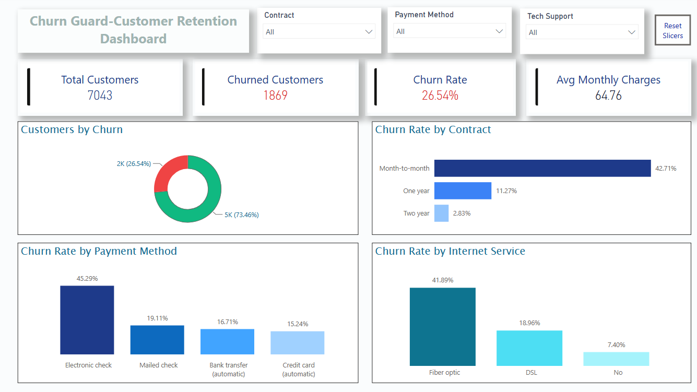

# Churn Guard: Customer Retention Analysis

An end-to-end data analytics project that explores why telecom customers
leave (churn). It uses Python for exploratory data analysis and Power BI for
an interactive retention dashboard.

## Dashboard Preview
   

## Project Overview
Customer churn directly reduces revenue. This project identifies which
customer groups are most likely to leave so the business can improve retention.
Overall, **26.54%** of customers in the dataset churned.

## Key Insights
- **Contract type:** Month-to-month customers churn far more than one- or two-year customers.
- **Tenure:** Customers in their first few months are the most likely to leave; long-tenure customers tend to stay.
- **Payment method:** Electronic check users show the highest churn.
- **Senior citizens:** A higher share of senior citizens churn compared with other customers.
- **Services:** Churn patterns differ across internet service and add-ons such as tech support.

## Tools & Technologies
- **Python:** pandas, numpy, matplotlib, seaborn
- **Jupyter Notebook:** data cleaning and EDA
- **Power BI:** interactive dashboard with KPI cards, charts and slicers

## Analysis Workflow
1. Load and inspect the data (`info`, `describe`)
2. Clean data: fix the `TotalCharges` data type, check for nulls and duplicates
3. Convert `SeniorCitizen` from 0/1 to yes/no
4. Visualize churn by gender, senior citizen, tenure, contract, services and payment method
5. Build the Power BI dashboard from the cleaned data

## Project Structure
```
├── data/        # Dataset (CSV)
├── notebooks/   # Jupyter analysis
├── powerbi/     # Power BI dashboard (.pbix)
├── images/      # Dashboard screenshot
├── requirements.txt
└── README.md
```

## How to Run
1. Clone the repository
```
   git clone https://github.com/Deepak4965/churn-guard-customer-retention-analysis.git
```
2. Install the requirements
```
   pip install -r requirements.txt
```
3. Open `notebooks/customer_churn_analysis.ipynb` in Jupyter Notebook and run all cells.
4. Open `powerbi/churn_guard_dashboard.pbix` in Power BI Desktop.

## Author
**Deepak** | [GitHub](https://github.com/Deepak4965)
